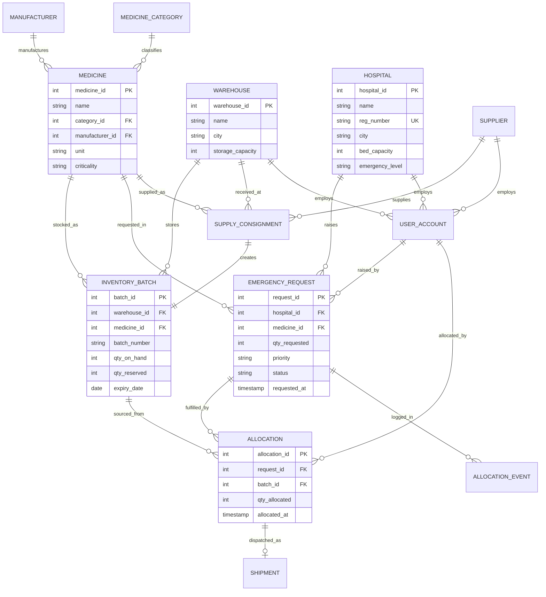

# ER / EER Model — MedSupply

## Entity Types

**Strong entities:** Hospital, Warehouse, Medicine, MedicineCategory, Manufacturer, Supplier, UserAccount, EmergencyRequest

**Weak entity:** InventoryBatch — identified by `batch_number` only within a warehouse. Partial key: `batch_number`. Full identification: `(warehouse_id, batch_number)`. Implemented with surrogate `batch_id` plus a UNIQUE constraint preserving weak-entity semantics.

**Associative entities:**
- Allocation — resolves M:N between EmergencyRequest and InventoryBatch, carrying `qty_allocated`
- SupplyConsignment — resolves M:N between Supplier and Medicine

**Dependent entities:** Shipment (1:1 with Allocation), AllocationEvent (audit log)

## EER Extensions

**Specialization:** UserAccount specializes into HospitalStaff, WarehouseStaff, SupplierUser, EmergencyCoordinator, Admin.

- Disjoint (d): a user holds exactly one role
- Total: every user has a role

**Mapping choice:** single table with `role` discriminator plus three nullable FKs (`hospital_id`, `warehouse_id`, `supplier_id`), constrained so exactly one is non-null for role-bound users.

Rejected alternative: table-per-subclass. Every authentication query would need a 5-way UNION, and subclasses differ by only one attribute each.

**Union type (category):** AllocationEvent.actor may be a UserAccount or the automated allocation engine. Modelled as nullable `actor_user_id` + `actor_type` enum, since PostgreSQL has no native category support.

## ER Diagram

## Cardinality and Participation

| Relationship | Cardinality | Participation |
|---|---|---|
| Hospital-EmergencyRequest | 1:N | Hospital partial, Request total |
| Medicine-InventoryBatch | 1:N | Medicine partial, Batch total |
| Warehouse-InventoryBatch | 1:N | Warehouse partial, Batch total |
| EmergencyRequest-InventoryBatch | M:N via Allocation | both partial |
| Allocation-Shipment | 1:1 | Allocation partial, Shipment total |
| Supplier-Medicine | M:N via SupplyConsignment | both partial |

**Why Allocation is M:N, not 1:N:** a request for 500 units may draw 200 from a batch expiring next month and 300 from another. Modelling it 1:N would force partial fulfilment into a single batch and eliminate the FEFO logic, multi-row locking, and most of the concurrency interest.
